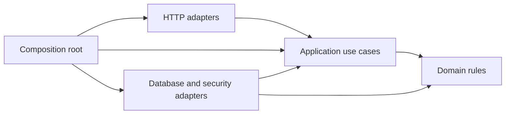

# Architecture

The backend uses a lightweight Clean Architecture in plain JavaScript. Business rules depend on application contracts rather than Express, Mongoose, bcrypt, or JWT libraries.

## Layers

| Directory | Responsibility | Dependencies |
| --- | --- | --- |
| `src/domain` | Access policies, application errors, pagination rules | Domain only |
| `src/application` | Authentication, notes, posts, user management, aggregation use cases | Application and domain |
| `src/infrastructure` | Mongoose repositories/models, transactions, aggregation pipelines, bcrypt, JWT, logging | Application contracts and domain |
| `src/interfaces/http` | Express routes/controllers, request validation, cookies, HTTP error/status mapping | Application and domain |
| `src/bootstrap` | Environment validation and dependency composition | Assembles all adapters and use cases |

`src/app.js` is the composition entrypoint shared by the local server and Vercel.



## Contracts and request flow

The composition root injects repository, transaction, password, and token objects into the use-case factories. JavaScript structural contracts keep the application independent of framework classes. The application tests replace these objects with small fakes; the integration tests use real Mongoose adapters and a replica set.

A note request follows:

```text
Express route -> validated input -> controller -> note use case -> repository contract -> Mongoose
```

The controller handles HTTP. The use case enforces access rules and chooses repository operations. Infrastructure converts Mongoose documents/ObjectIds into plain records/string IDs before returning them inward.

Database-specific errors are translated in infrastructure. HTTP adapters map application error codes to status codes and do not inspect MongoDB error types. Transaction errors retain their MongoDB retry labels until transaction execution finishes.

## Transactions

A write use case calls the transaction port. It locks the current active account by matching its role and session version and incrementing its write version. Content changes and cascading account deletion use repositories bound to the same transaction. This prevents stale sessions and creation/deletion races from leaving orphan records.

## Public and private data

- Notes require authentication; users read and change their own notes.
- Administrators can read all notes and manage users; they cannot edit another user's note.
- Posts are public to read, as required by Scenario 2.
- Public posts-by-username responses contain only the username, public posts, and pagination.
- Names, email addresses, interests, roles, and session fields are excluded from the public user response.
- Interest groups require an administrator and include paginated usernames per group.

## Indexes and aggregations

All five application indexes are declared with `schema.index()` in `src/infrastructure/database/models`.

| Index | Queries it supports |
| --- | --- |
| `users_email_unique` | Unique registration and email login |
| `users_username_unique` | Unique usernames, username login, public user-post lookup |
| `users_interests_id` | Exact-interest filtering and deterministic member pagination inside each interest group |
| `notes_owner_id` | Owner notes ordered by ID, owner counts, cascading deletion |
| `posts_author_id` | A user's posts ordered by ID, correlated lookup, cascading deletion |

MongoDB's built-in `_id_` indexes serve single-record reads and global user/note/post lists. No duplicate `_id`, standalone owner/author, or timestamp indexes are added.

Interest grouping performs exactly one `User.aggregate()` call. It paginates groups before looking up their members, so member results remain bounded. The users-by-interest lookup uses the existing multikey interest index.

User-post retrieval performs one `User.aggregate()` call with one `$lookup` into Posts, an indexed author match, deterministic ordering, and a facet for data and totals.

## Checks

`npm test` runs application tests, the dependency-direction test, and API tests with a real isolated MongoDB replica set. API tests cover ownership, admin roles, revoked sessions, transaction rollback/races, public-data privacy, nested pagination, aggregate-call counts, declared indexes, and explain plans.
